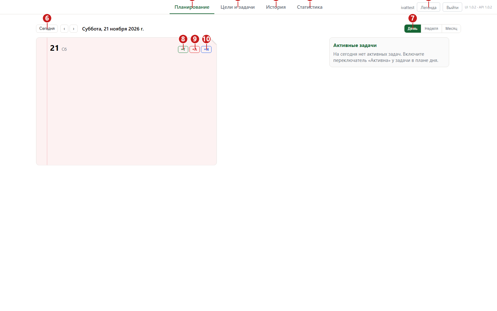
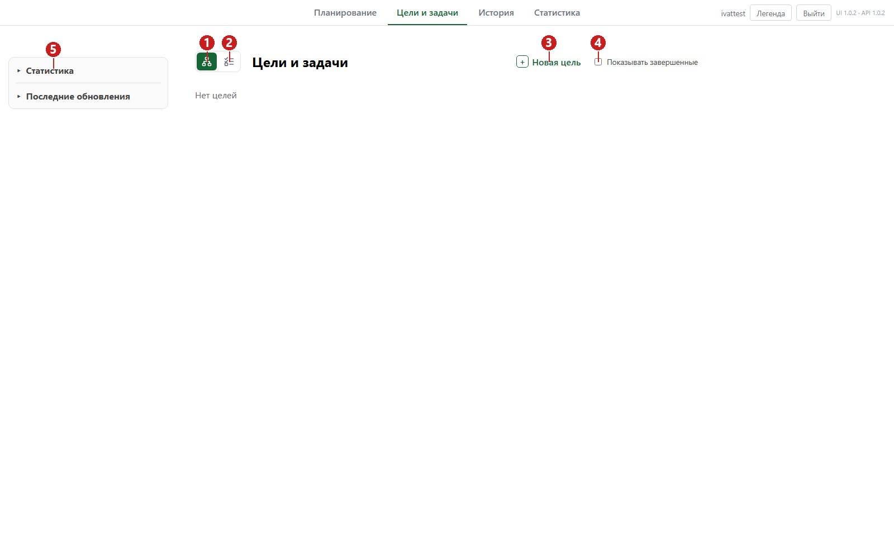
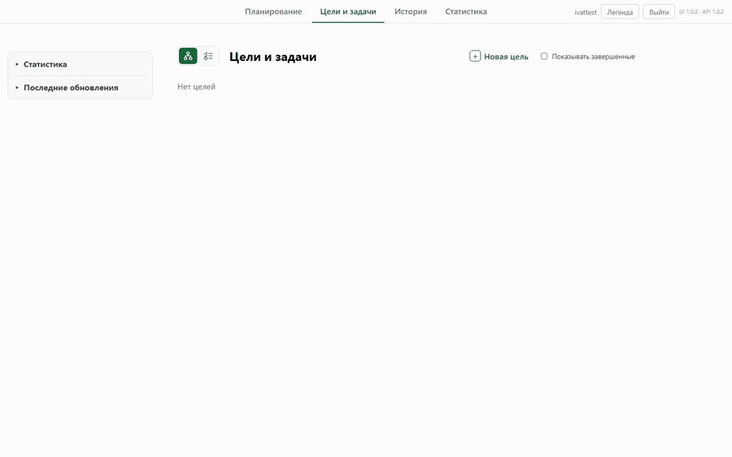
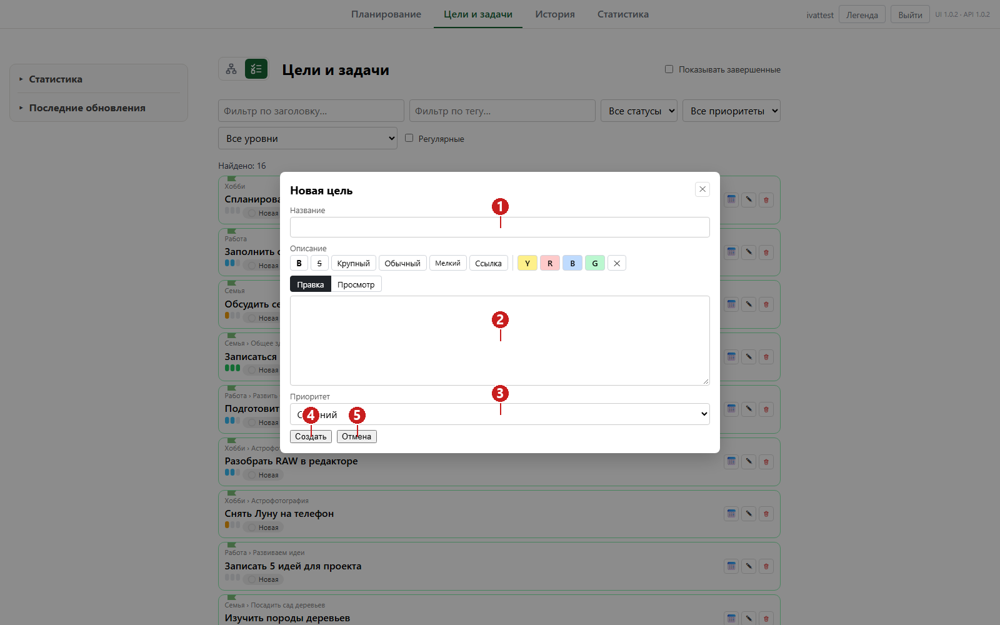
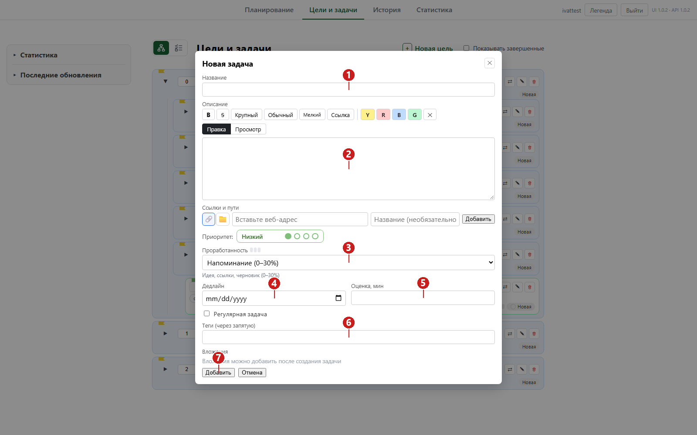
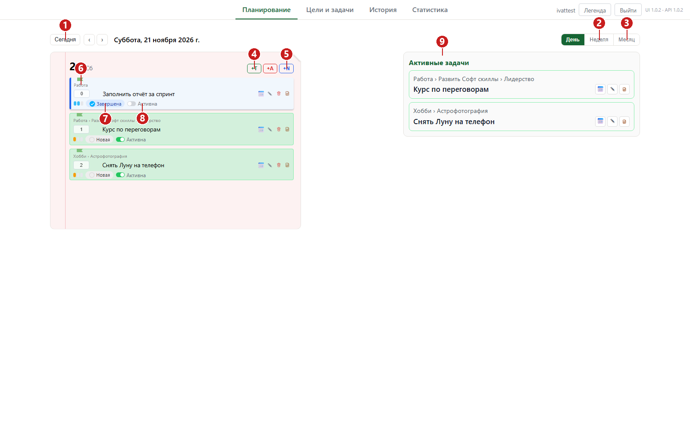
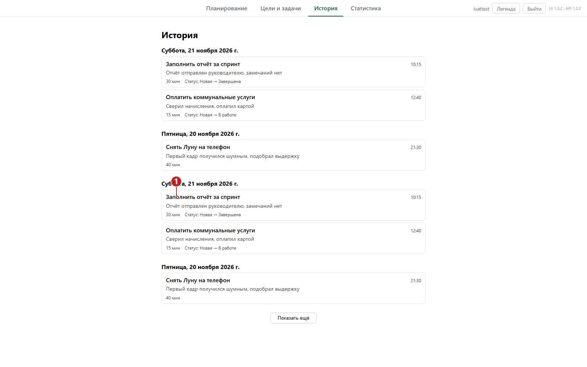
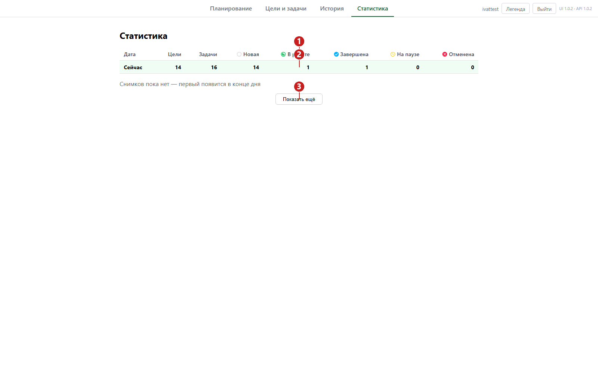

# VGoalsPlanner — руководство пользователя

Документ снят на пустой тестовой базе: сначала показано, как приложение выглядит «с нуля»,
затем — как из этого нуля вырастает рабочее дерево целей, план на неделю и отчёт по сделанному.

Все картинки лежат в папке `images/`, анимация создания дерева — `images/goals.gif`.

---

## 1. Что видно при первом входе

После авторизации открывается вкладка расписания. Ничего не заполнено — и это нормальное
стартовое состояние: приложение ничего не придумывает за вас.

<table>
<tr>
<td width="62%" valign="top"></td>
<td valign="top">

**Верхняя строка — четыре раздела.**

1. **Планирование** — календарь на день, неделю или месяц и список дел на выбранную дату.
2. **Цели и задачи** — дерево «зачем → что» и плоский поиск по всем задачам.
3. **История** — что было сделано в каждый день: записи журнала и сводка на конец дня.
4. **Статистика** — таблица по датам: сколько целей и задач и в каких они статусах.

**Правый верх.**

5. **Легенда** — шпаргалка по цветам приоритетов и значкам статусов.

**Шапка календаря.**

6. **Сегодня** — мгновенный возврат к текущей дате (стрелки рядом листают дни).
7. **День / Неделя / Месяц** — масштаб календаря.

**Кнопки внутри плитки дня.**

8. **+T** — добавить задачу сразу на этот день.
9. **+A** — добавить напоминание (звонок, дедлайн, встреча).
10. **+N** — записать заметку дня: свободный текст, который потом видно в «Истории».

Справа от календаря — блок **Активные задачи**: те дела дня, у которых включён переключатель
«Активна». Пока таких нет, блок подсказывает, что делать.

</td>
</tr>
</table>

---

## 2. Раздел «Цели и задачи» до первой цели

Переходим во вторую вкладку. Дерева ещё нет, зато видно всё управление.

<table>
<tr>
<td width="62%" valign="top"></td>
<td valign="top">

1. **Значок дерева** — иерархический вид: цель, подцели, задачи. Основной режим работы.
2. **Значок списка** — плоский вид: все задачи одной лентой, без вложенности. Удобно для поиска.
3. **«+ Новая цель»** — создаёт цель верхнего уровня. Дочерние цели создаются кнопкой `+`
   уже внутри существующей цели.
4. **«Показывать завершенные»** — выключатель фильтра. По умолчанию выполненное и отменённое
   скрыто, чтобы дерево не разрасталось.
5. **Сворачиваемые панели слева** — «Статистика» и «Последние обновления»: быстрый взгляд
   на цифры и на то, что менялось последним, не уходя из дерева.

</td>
</tr>
</table>

---

## 3. Создание дерева целей

Анимация ниже показывает весь процесс: одна цель верхнего уровня, затем её дочерние,
затем вложенные подцели — без перезагрузок и без отдельных экранов настроек.

Порядок действий на каждой цели одинаковый: навести на цель → нажать `+` (или «+ Новая цель»
для верхнего уровня) → вписать название → «Создать» / «Добавить». Родитель подставляется
автоматически — тот, внутри которого нажали плюс.

Что должно получиться в итоге (слева — родитель, справа — его дети):

| Родитель | Дочерняя цель |
|---|---|
| Семья | Бытовые вопросы |
| Семья | Общее здоровье |
| Общее здоровье | Спорт |
| Семья | Путешествия |
| Семья | Построить дом |
| Семья | Посадить сад деревьев |
| Работа | Развить Софт скиллы |
| Развить Софт скиллы | Лидерство |
| Развить Софт скиллы | Бизнес Аналитика |
| Работа | Развиваем идеи |
| Хобби | Астрофотография |

> Если дерево получилось слишком глубоким, это не ошибка: три уровня — обычная глубина.
> Главное, чтобы у каждой задачи был виден путь наверх.

---

## 4. Окно создания цели

<table>
<tr>
<td width="62%" valign="top"></td>
<td valign="top">

1. **Название** — единственное обязательное поле. Коротко и предметно: «Посадить сад деревьев»
   лучше, чем «Разное про дачу».
2. **Описание** — зачем цель нужна и как вы поймёте, что она достигнута. Поле необязательное,
   но именно оно спасает через полгода.
3. **Приоритет** — четыре ступени; цвет точки потом виден и в дереве, и в календаре.
4. **Создать** — цель появляется в дереве сразу, с пустым набором задач.
5. **Отмена** — закрывает окно без сохранения.

</td>
</tr>
</table>

---

## 5. Окно создания задачи

Открывается зелёным `+` внутри цели либо кнопкой **+T** в календаре.

<table>
<tr>
<td width="62%" valign="top"></td>
<td valign="top">

1. **Название** — что именно сделать. Проверка простая: это должно быть действие,
   которое можно начать и закончить.
2. **Описание** — подробности в редакторе с разметкой: жирный, заголовки, ссылки, цветной текст.
   Переключатель «Правка / Просмотр» показывает, как это будет выглядеть.
3. **Проработанность** — четыре ступени: от «напоминания» (идея, черновик) до «детально»
   (есть шаги, оценка и ресурсы). Уровень рисуется тремя сегментами рядом с названием задачи.
4. **Дедлайн** — дата, к которой задача должна быть закрыта.
5. **Оценка, мин** — сколько времени понадобится. Нужна, чтобы не набирать на день больше,
   чем в нём есть часов.
6. **Теги** — через запятую; по ним потом работает поиск.
7. **Добавить** — сохраняет задачу. Вложения удобнее прикреплять уже к созданной задаче.

</td>
</tr>
</table>

---

## 6. Планирование

Возвращаемся в первую вкладку: задачи, созданные в дереве, появляются здесь, как только
им назначен день.

<table>
<tr>
<td width="62%" valign="top"></td>
<td valign="top">

1. **«Сегодня»** — возврат к текущей дате.
2. **«Неделя»** — семь плиток подряд; видно, где перегруз.
3. **«Месяц»** — сетка на месяц: удобно ловить дедлайны и пустые промежутки.
4. **+T** — новая задача прямо в этот день.
5. **+N** — заметка дня.
6. **Карточка задачи** — путь цели сверху, номер порядка, название, кнопки действий справа.
7. **Статус** — «Новая», «В работе», «Завершена», «На паузе», «Отменена».
8. **«Активна»** — переключатель; активные задачи поднимаются в колонку справа.
9. **Колонка «Активные задачи»** — то, что вы делаете сегодня. На узком окне она уезжает
   под календарь, чтобы не давить на список.

Рядом со статусом стоит иконка проработанности — те же три сегмента, что и в дереве:
серый (идея), жёлтый (изучить), голубой (готова к работе), зелёный (детально).
Клик по названию открывает описание, значок календаря ставит задачу на другой день,
значок документа открывает журнал.

</td>
</tr>
</table>

---

## 7. История

Вкладка собирает прошедшие дни в одну ленту.

<table>
<tr>
<td width="62%" valign="top"></td>
<td valign="top">

1. **Запись журнала** — задача, заметка о работе, потраченное время и переход статуса.
   Это и есть ответ на вопрос «что я сделал в среду».

Под записями дня идёт **сводка на конец дня**: сколько целей и задач было у вас в этот день
и как они распределились по статусам. Кнопка внизу подгружает более ранние дни.

</td>
</tr>
</table>

---

## 8. Статистика

<table>
<tr>
<td width="62%" valign="top"></td>
<td valign="top">

1. **Шапка таблицы** — что именно считается: цели, задачи и четыре статуса.
2. **Строка «Сейчас»** — текущее состояние на момент открытия вкладки.
3. **«Показать ещё»** — подгружает историю глубже.

Ниже строки «Сейчас» идут снимки на конец дня: их пишет фоновое задание, поэтому со временем
таблица сама превращается в дневник движения задач.

</td>
</tr>
</table>

---

## 9. Как найти нужную задачу

В разделе «Цели и задачи» переключитесь на значок списка и пользуйтесь фильтрами над списком:
часть названия, тег, статус, приоритет, уровень проработанности и отдельный фильтр
для повторяющихся задач. Фильтры складываются: например, «тег `фото` + статус `В работе`»
оставит только то, что вы действительно делаете сейчас. Рядом со счётчиком найденного
появляется значок выбранного уровня проработанности — чтобы не забыть, какой фильтр включён.

---

## 10. Ежедневный цикл в трёх шагах

1. Утром — «Планирование», день: включить «Активна» у двух-трёх задач, остальные оставить на потом.
2. Вечером — открыть журнал каждой активной задачи: записать, что сделано, сколько времени ушло,
   и перевести статус.
3. Раз в неделю — «История» за неделю и «Статистика»: видно, где план разошёлся с реальностью.

---

### Служебное

- Данные для документа созданы на отдельной базе `vgplanner_demo`, реальные данные не использовались.
- Скриншоты — 1600×1000, сняты автоматически; GIF собран из кадров браузера.
  Программу ScreenToGif для этого запускать не пришлось: запись идёт покадрово, поэтому
  анимацию можно пересобрать одной командой, не повторяя руками.
